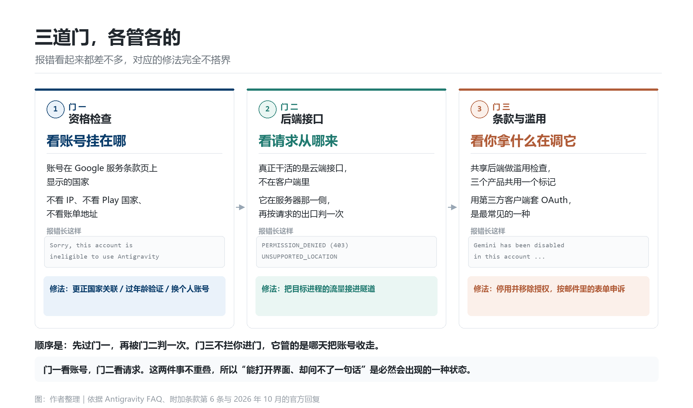
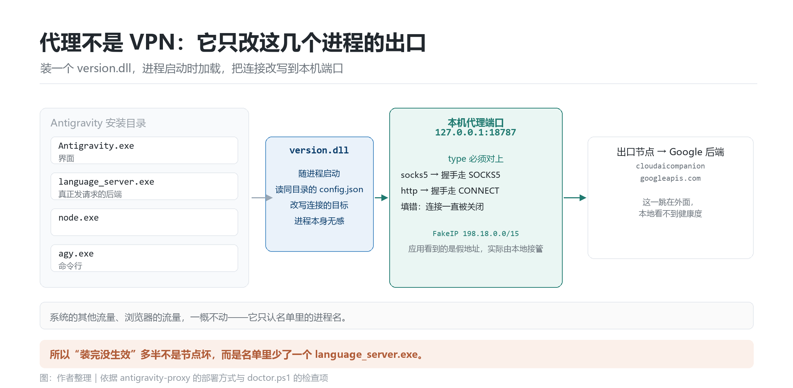
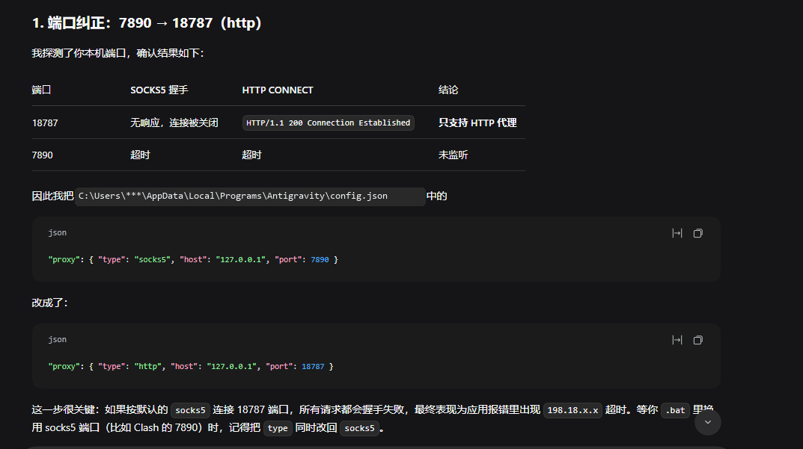
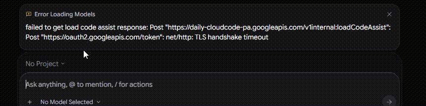
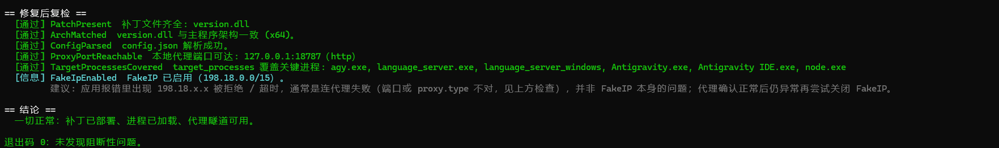
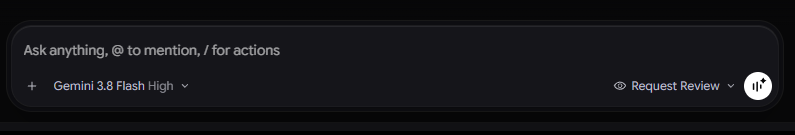

# Antigravity 说你不符合资格：挡住你的不是 IP，是账号的“国籍”

11 月 25 日下午，我把 Antigravity 装好，登录，屏幕上出现两行字：

> Sorry, this account is ineligible to use Antigravity
> Your current account is not eligible for Antigravity, because it is not currently available in your location.

第一反应是网络。换节点、切全局、挑美区机房，一轮折腾下来，那两行字一个字都没变。

因为它在看的不是你的连接从哪儿进来。它看的是这个 Google 账号在服务条款页上挂的那个国家。

这句话只有一行，但它背后是三道互不相通的门。时间之所以会耗光，通常不是门太难开，是在修错的那一道。



## 一、三道门，各管各的

门一是资格检查。官方 FAQ 列了五项：国家/地区关联、年龄、账号类型、账号验证、有没有条款标记。五项里只有第一项和“你在哪儿”有关，而它认的是 policies.google.com/terms 页面上显示的那个国家。Google 工作人员在开发者论坛里说得很直白：不是 IP，不是 Google Play 国家，也不是账单地址。

门二在后端。界面能起来，是因为界面在本地；模型列表和对话要打到 `cloudaicompanion.googleapis.com`。这一跳发生在服务器那一侧，它会按请求的出口再判一次。日志里那行 403 就是这儿来的：

```
ERROR: PERMISSION_DENIED (code 403): Your current account is not eligible for
Gemini Code Assist for individuals because it is not currently available in your location.
reason: UNSUPPORTED_LOCATION, domain: cloudaicompanion.googleapis.com, error_number: 1008
```

门三不是技术问题，是条款。滥用检查在共享的后端层，附加条款第 6 条禁止“把本服务与并非由我们提供的产品搭配使用”，并且点名了 OpenClaw 配 Antigravity OAuth 这种用法。它的后果不是“不能用”，是“哪天不能用”。

三道门叠在一起，会得到一个反直觉的结论：**门一看账号，门二看请求，这两件事不重叠。** 所以“界面能开、模型能选、一问就报错”不是 bug，是一种可以稳定复现的状态。谁把它当 bug 修，就会一直在门口打转。

这套设计有个好处：IP 会变，账号不会。按账号判，结果可复现、可申诉，也能和套餐与计费对上。

顺带记个数。FAQ 的支持列表是 224 个国家和地区：美洲 51、欧洲 47、非洲 56、亚洲 43、大洋洲和南极洲 27。截至 2026 年 10 月 30 日，中国大陆、香港、俄罗斯、白俄罗斯、摩尔多瓦、伊朗、叙利亚、朝鲜、古巴不在里面；乌克兰在。早期流传的“乌克兰不支持”“200 多个国家”两处都已过时——这类清单会变，只认实时的那一份。

## 二、七种报错，先对号

| 报错（截取） | 它在说什么 | 先修哪儿 |
| --- | --- | --- |
| `ineligible to use Antigravity` | 资格检查没过；第二行带 location 就是国家问题 | 门一 |
| `not available in your location` | 账号国家不在列表，或刚改完还没同步 | 门一 |
| `Eligibility check failed`（CLI） | 登录成功了，账号检查没过；后端是 403 `VALIDATION_REQUIRED`，不一定是地区封锁 | 门一 + 验证 |
| `Further action is required` | 地区这一关已经过了，卡在账号验证；最常见的形态是死循环 | 验证 |
| `not eligible for ... AI plans` | 这是套餐权益，不是登录界面；只看国家和年龄 | 门一（套餐） |
| `unexpected issue setting up your account` | 设置阶段挂了：令牌残留、改区没生效、续费延迟 | 本地重置 |
| `Gemini has been disabled ... Terms of Service` | 条款封禁，三个产品一起中招 | 门三 |

第四条值得单独说一句。Google 工作人员的回复是：看到这个界面而不是地区提示，说明地区已经通过，卡的是账号的安全与验证检查。所以在这一条上换节点、改国家，全是白费。

## 三、按顺序动手

### 先确认“国籍”

打开 policies.google.com/terms，看页面上写的国家。

在列表里，直接跳到下一节。不在列表里、而它确实不是你现在的居住地（搬过家、账号在别处注册），用国家/地区关联表单去更正。不在列表里、而你就住在那里——到这儿就结束了，这个账号现在用不了。

那张表是用来更正真实国家的，不是绕开可用性的工具。填一个不存在的居住地，等于在账号上留一笔以后要还的债。

年龄这一关在同一个地方：18 岁以上，去 myaccount.google.com/age-verification。可能要证件或信用卡；信用卡是授权不是扣款，证件在确认出生日期之后删除。刚改过年龄的，Google 说要等 24 到 48 小时才同步。

### 再处理验证循环

这条最反直觉：**验证可能验到了别的账号上**。

浏览器里登着多个 Google 账号时，你在应用里点 Verify，跳过去的那一次，未必作用在你以为的那个会话上。结果是浏览器显示“验证成功”，应用里还是同一句提示——一个看起来无解的死循环。

做法很土：退出所有其他账号，只留一个；或者干脆开隐私窗口，只登那一个。确认两步验证开着，恢复手机号是普通号码。验完别急着点第二次，等几分钟（用多个账号试过的，等 30 到 60 分钟），把应用完全退出（托盘里也退）再重开。

如果浏览器停在 `accounts.google.com/signin/continue` 显示 500 或“We couldn't verify your info”：别再顺着跳转走，直接开年龄验证页做完；同时关掉 VPN、代理和那些会改请求头的扩展，它们会让验证页认不出你。

### 清掉本地残留

应用里点“退出登录”不撤销服务器端的授权。去 myaccount.google.com/permissions，把 Antigravity 移除。

然后在应用里按 `Ctrl+Shift+P`，跑一次 Antigravity: Reset Onboarding；命令行里 `/logout`、`agy update` 再来。网上流传的删 `auth-tokens` 目录是社区办法，官方文档没写，非删不可的话先确认那个目录真的存在。

### 把流量接进隧道

到这里才轮到代理。先说清楚它是什么：它不是 VPN，不改系统路由，只在几个进程启动时加载一个 `version.dll`，读同目录的 `config.json`，把连接的目标改写到本机端口。



最后落在机器上的是这么一段，三处都能单独把人卡住：

```json
{
  "proxy": { "host": "127.0.0.1", "port": 18787, "type": "http" },
  "child_injection": true,
  "target_processes": ["Antigravity.exe", "language_server.exe", "language_server_windows", "node.exe"]
}
```

- `type` 写 `socks5` 还是 `http`，得看那个端口说什么方言。混合端口两种都行，HTTP 专用端口必须写 `http`。写错的表现是握手一直被关闭，看起来像节点挂了。
- `target_processes` 里必须有 `language_server.exe`。少了它，界面走代理、后端直连，症状正好是“能开、不能问”。
- `port: 0` 是全部直连，等于把开关关掉。
- 这个 DLL 只在进程启动时读配置。改完必须重启应用，改完就试是最常见的白忙一场。

还有一条不太像技术问题的规矩：补丁的母本目录必须放在安装目录之外。应用更新会覆盖安装目录，母本放在里面就一起被删了。

顺带回答一个常被问的：免费账号可以用。判据是能不能打开 Google AI Studio——能打开，说明这个账号和这条链路都活着。

## 四、四个坑：症状指错了地方

下面四个都是我实际踩过的，共同点是：报错指向的位置，都不是病灶。

### 端口方言：它只说 HTTP



这张诊断值得记住：18787 对 SOCKS5 无响应、连接被关闭；换成 HTTP CONNECT，回 200。结论只有一句——这个端口只说 HTTP。另一个 7890 不是“没配好”，是压根没有进程在那个端口上监听。

配置里原本写的是 `socks5` + `7890`，两处都不对。改成 `http` + `18787`，握手才通。

一个端口同时支持两种协议很常见，但“支持”和“默认”是两件事。工具的默认值，不等于你手上那个代理的默认值。

### TLS handshake timeout：请求根本没出隧道



应用更新之后，模型列表刷不出来，弹的是这一行：

```
failed to get load code assist response:
Post "https://daily-cloudcode-pa.googleapis.com/v1internal:loadCodeAssist":
Post "https://oauth2.googleapis.com/token": net/http: TLS handshake timeout
```

三个细节。`net/http` 说明发请求的是那个 Go 写的后端进程，不是界面。TLS handshake 卡住，说明 TCP 连上了、握手没完成——这是“隧道不通”的形状，不是“账号不符”。而“界面能开”这件事，从头到尾都不是“能用”的证据。

处理顺序：先重启代理软件，再跑一次 `doctor.ps1 -Action Repair`，最后才开应用。

### 198.18.x.x：假地址说明流量进去了

代理软件用一个保留网段做假地址：198.18.0.0/15，叫 FakeIP。应用以为自己在连真域名，实际连的是本地代理，由它接管。

所以报错里出现 198.18.x.x，是在告诉你一件好事：流量进去了，坏的是隧道那一头。排错方向立刻从“应用坏了”改成“代理链路坏了”——这是两个成本差十倍的方向。

反过来，如果报错是域名解析失败、或者连一个真实 IP 超时，那才说明根本没进代理。

### 更新之后：补丁没了，跑一次 Repair



这份输出值得逐行看：补丁文件齐全、架构对得上、config 解析成功、`127.0.0.1:18787 (http)` 可达、名单覆盖 `agy.exe`、`language_server.exe`、`language_server_windows`、`Antigravity.exe`、`Antigravity IDE.exe`、`node.exe`，FakeIP 开着。结论一行：一切正常。

它同时说明另一件事：这套东西的健康状况是可以被检查的，不必靠“打开试试”。退出码只有四种：0 健康、1 需修复、2 修复未完成、3 环境问题。看到 3 就别再动配置了，那不是配置的问题。

## 五、边界

这套办法能让一个账号在这台机器上跑起来，但它不改变条款。

附加条款第 6 条还在那儿。2026 年 2 月 27 日，Google 在 gemini-cli 的讨论区里给过恢复流程：对近期被标记的账号做过一次系统范围的自动解封；今后被标记的会收到一封邮件，和一条指向 Google 表单的错误信息；读完条款、重新确认遵守，账号通过定期同步恢复，通常一两天；第二次违规是永久封禁。

还有一句要记住：滥用检查在共享的后端层，所以 Antigravity、Gemini CLI、Code Assist 共用同一个标记。在应用、CLI、IDE 之间换着试，清不掉它。

边界也很明确。`agy -p` 的无头模式给自己的脚本和 CI 用，是允许的；把 `agy` 包进第三方编码代理、或者自动轮换账号，不支持。正经要上生产，路是 Gemini Enterprise 或者 AI Studio 的 API key。

把“能不能用”当成配置问题，比当成立场问题好办得多。但如果这套流程要长期跑，最好别把工作建在这条路上。

## 六、最后一问



回头看花掉的时间：装代理不到二十分钟，剩下的全在搞明白那两行字到底在说什么。

所以排错最贵的一步，不是修，是判断该修哪一层。修错一层，你会攒下一堆“我也照做了”的无效经验，最后开始怀疑是运气问题。

## 附录

- [Antigravity FAQ](https://antigravity.google/docs/faq)：支持地区、年龄、第三方软件、无头模式
- [Antigravity 附加条款](https://antigravity.google/terms)第 6 条
- [Google 关于封禁与恢复的帖子](https://github.com/google-gemini/gemini-cli/discussions/20632)
- [CLI 403 的用户日志](https://github.com/google-antigravity/antigravity-cli/issues/785)
- [antigravity-proxy](https://github.com/yuaotian/antigravity-proxy)：本文用的补丁
- [账号国家关联表单](https://policies.google.com/country-association-form)
- [年龄验证](https://myaccount.google.com/age-verification)

文中截图来自作者本机，2026 年 11 月 25 日，项目名、用户名与对话内容均已隐去；示意图为作者自绘。可用性以官方页面为准。