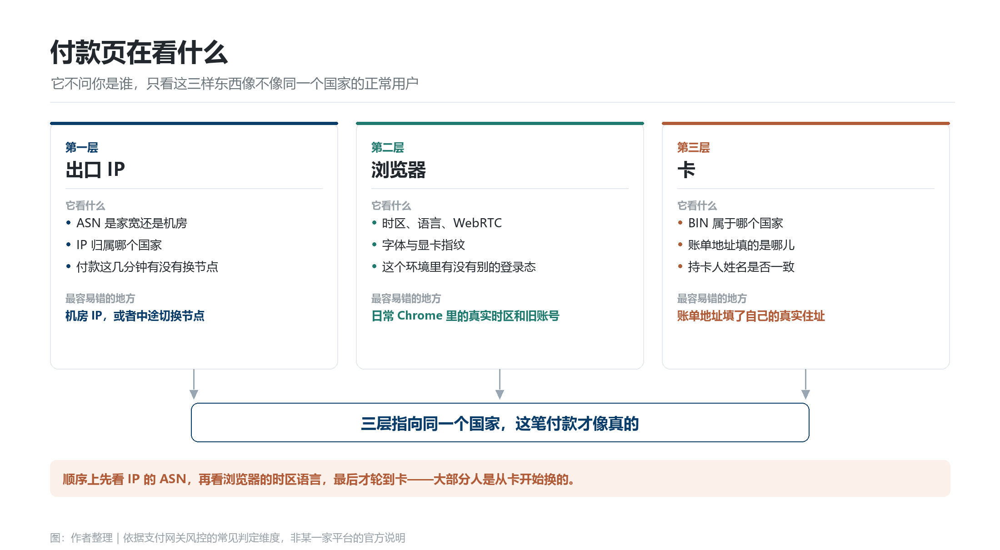
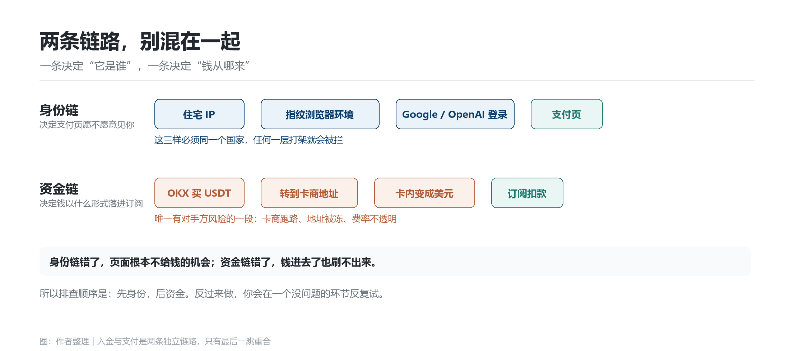

付款页上那句 `Your card was declined`，我见过三种反应：换一张卡、打电话问银行、再换一张卡。

钱其实一直在。被拒的是"这一笔看起来不像一个正常的当地用户"——而这跟余额、跟卡能不能用，是两件事。

## 一、它到底在核对什么

支付网关不问你护照号，它算一个概率：这笔交易像不像这个国家的正常消费者。输入有三个：

- **出口 IP**：属于哪个国家，ASN 是家宽（ISP）还是机房（hosting）
- **浏览器**：时区、语言、WebRTC 暴露的真实 IP、字体与显卡指纹、这个环境里的历史登录态
- **卡**：BIN 属于哪个国家、账单地址填的是哪、持卡人姓名与账号是否对得上

三个都指向同一个国家，就是一笔普通的订阅。只要有一层和另外两层打架——机房 IP 配美国卡、美国 IP 配中国时区、美国 BIN 配一个中国住址——风控模型就会把它挑出来。

所以这套流程的本质不是"破解"，是**别自相矛盾**。矛盾是会被算出来的。

## 二、第一层：IP

机房 IP 和住宅 IP 在风控里不是一个价位的东西。云厂商的 ASN 天然带着"这里是服务器"的标签，同一个号段上跑着爬虫、注册机、别人被封的账号。所以哪怕国家填对了，hosting ASN 也会先被降权。

住宅代理的逻辑就是把出口放在别人家的宽带上，ASN 属于当地运营商。我用的是 ROLA-IP 这类动态住宅池，选目标国家的节点。

两个细节比"买哪个套餐"更影响成败：

**付款那几分钟必须是同一个 IP。** 动态池会轮换，得挑支持粘性会话（sticky session）的用法，或者干脆按小时锁定一个出口。中途换 IP 等于自己举报自己。

**从注册到付款，全程同一条出口。** 谷歌账号在这里注册、OpenAI 在这里登录、卡在这里绑定——三件事发生在三个 IP 上，就等于告诉对方"这个人在移动"。

## 三、第二层：浏览器

很多人以为指纹浏览器的用处是"多开"。在这个场景里，它的用处是**把身份固定下来**。

日常那个 Chrome 里有什么：你的真实时区、中文语言偏好、一堆登录态、WebRTC 会绕过代理直连暴露真实内网 IP、还有过去几年积累的历史。这些东西和刚买的美国 IP 摆在一起，矛盾得非常明显。

[AdsPower](https://www.adspower.com/) 这类工具做的事很朴素：一个"环境"一套独立的 cookie、UA、时区、语言、Canvas/WebGL 指纹，再把环境的代理指向上面那个 IP。打开这个环境，就是一个"住在美国、用美国 IP 的浏览器"。

规矩只有一条：**一个环境 = 一个身份 = 一个 IP = 一张卡**，不混用。别在这个环境里登自己的主账号——那等于把两个身份焊在一起，之后哪个出事都会牵连另一个。

环境建好先自检一遍：浏览器里查 IP 归属、查时区、查 WebRTC 有没有漏真实地址。这一步花两分钟，能省掉后面两小时的怀疑人生。

## 四、第三层：卡

U 卡是预付性质的虚拟卡，卡号是美国的 BIN，钱先充进去、再刷出来。我用的这家（[roogoo 的邀请链接](https://wap.roogoo.shop/register?inviteCode=a595uq)，带邀请码：你开卡免费，我会有一点返佣，介意的话去掉 `inviteCode` 直接访问）开卡流程是注册、实名、开卡、入金。

卡这一层最容易错的地方，不是 BIN，是**账单地址**。BIN 是卡商给的，改不了；账单地址是自己填的，很多人顺手填了真实住址——美国卡配中国地址，这一条就够拒了。填卡商给的那个美国地址，和卡一致。

第二容易错的是钱怎么进去。流程是：在 [OKX](https://www.okx.com/) 买 USDT，提到卡商给的收款地址，到账后在卡内换成美元余额。这一段和支付本身没有关系，是两条独立的链——但它是整条流程里唯一有对手方风险的一段，后面单独说。

费用要算清楚：开卡费、充值手续费、货币转换、汇率点差，叠起来通常在小几个百分点。二十美元的订阅，别只充二十。

## 五、顺序比细节重要

1. 买 IP：目标国家、住宅、能锁会话
2. 建环境：绑代理，自检 IP / 时区 / WebRTC
3. 注册与登录：Google 账号、OpenAI，全程不换环境
4. 开卡入金：注册、开卡、USDT 入金、记下账单地址
5. 付款：填卡号 + 卡商地址 + 姓名，等结果

失败时按这个顺序查，别按直觉查：

- **页面根本不让进 / 提示地区不支持** → 第一层，IP 的 ASN 或国别不对
- **能进、但付款页一提交就拒** → 第二层或第三层，先看时区语言，再看账单地址
- **卡在"处理中"很久，最后失败** → 第三层，余额、3DS 验证、或者卡商风控
- **付款成功但账号被限** → 不在这三层里，是平台的事

大部分人从"换卡"开始查，因为卡是最容易换的东西。但顺序错了，换十张卡也没用。

## 六、代价

这一节比前面五节都重要。

**违反平台条款。** OpenAI 的服务地区限制写在条款里，用代理和异地卡订阅这件事本身就不合规。平台有权封号、有权不退款，而且它不需要给你理由。付了一年的钱，第 364 天被封，也是可能的。

**卡商是单点风险。** 虚拟卡服务商的资金池、合规资质、跑路概率，没有一样是你控制的。别把长期余额放在里面，用多少充多少。

**入金的合规性是另一件事。** 用加密货币给境外卡充值，在不同地区的法律定性不一样，税务和外汇也各有说法。这一段我不替你做判断。

**成本不低。** 住宅 IP 按流量或时长计费、开卡费、充值费、汇差，加起来比订阅标价高一截。它解决的是"能不能付出去"，不是"划不划算"。

**还有一条更便宜的替代方案**：找人代充。代价是把账号交出去，风险和上面完全不同——但对你可能更划算，这取决于你更怕封号还是更怕被盗。

## 七、最后

这套流程跑通之后，你会有一个很具体的感受：为了一个本该三分钟完成的付款，你花了两小时，学到了三层风控的样子。

值不值，取决于你要的是"用上"，还是"用得久"。前者一次对齐就够，后者需要一条稳定不换的链路——同一个 IP、同一个环境、同一张卡，长期不动。

最贵的从来不是订阅费，是中间那些看起来省事、其实让你不知道自己卡在哪一步的操作。
